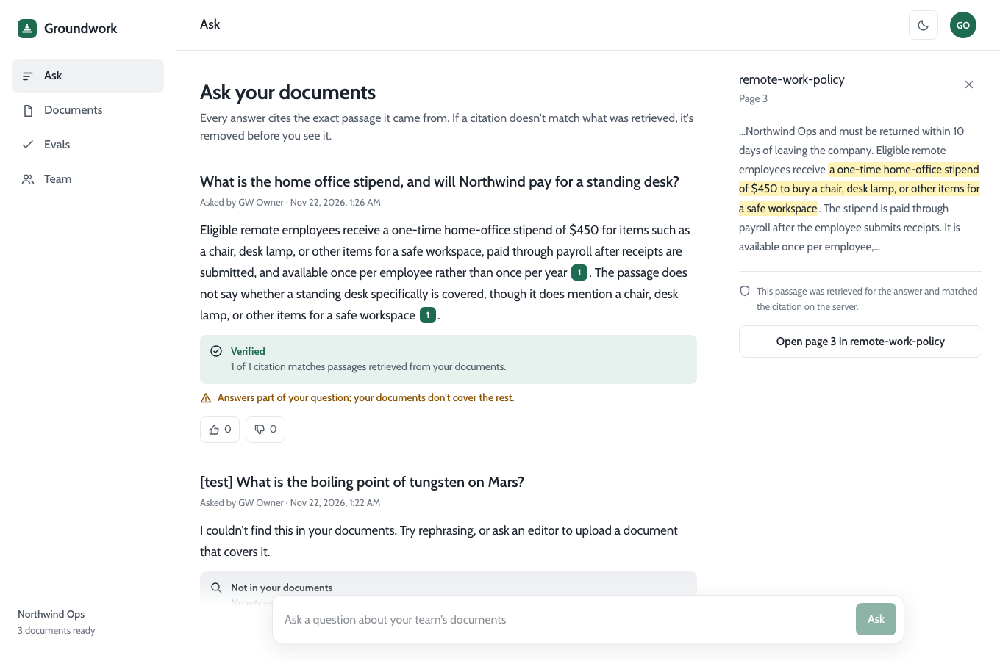
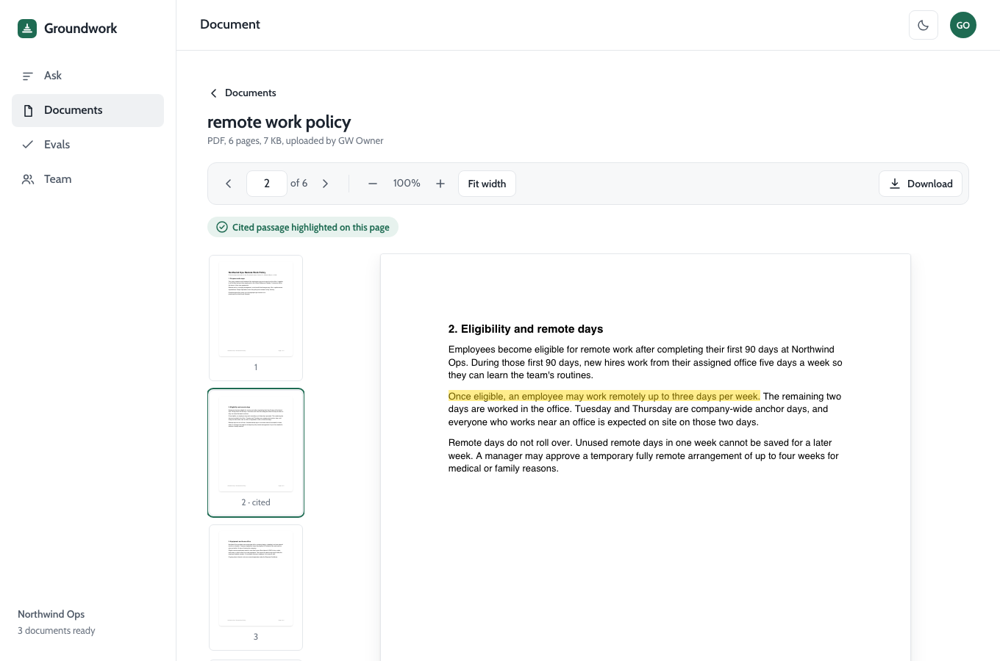
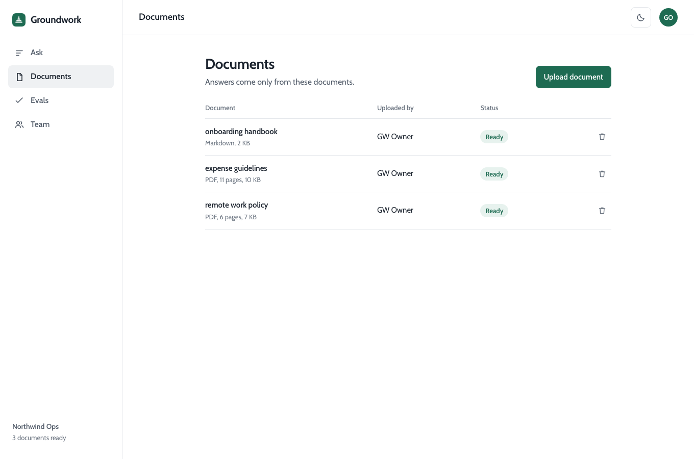
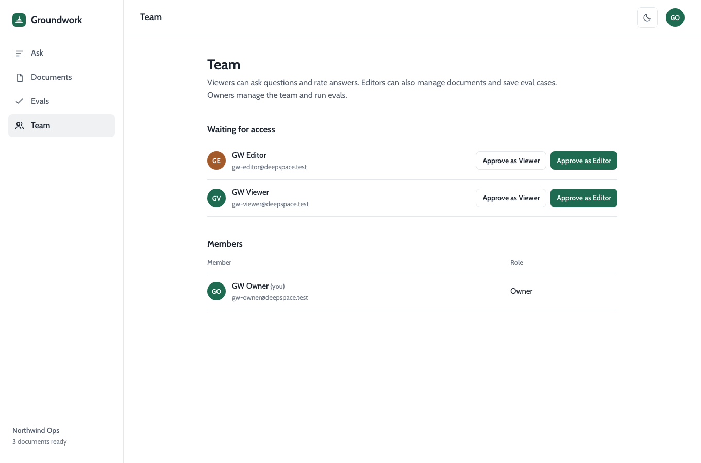

# Groundwork

A team knowledge assistant that answers questions from your team's documents, cites the exact passages it used, and refuses to cite anything it didn't actually retrieve.

**Live:** https://groundwork.app.space (private: sign in with Google, Microsoft, Apple or GitHub, then wait for the owner to approve you)

Built on the [DeepSpace](https://docs.deep.space) SDK (Cloudflare Workers, React). The full plan, design decisions, verification log and SDK feedback are in [PLAN.md](PLAN.md).

| Ask, with a verified answer and its source | Cited passage highlighted on its page |
|---|---|
|  |  |
| **Documents** | **Team access approvals** |
|  |  |

Every screen at desktop and phone width, light and dark: [docs/screenshots/](docs/screenshots/) (sign-in, loading, waiting for access, welcome, Ask, Ask with live steps, Ask error, reconnecting, source panel, Documents, documents loading, upload dialog, drag-over, upload progress, PDF viewer, Markdown viewer, Evals, Team, role dropdown, 404).

## What it does

1. **Upload** a PDF, Markdown or text file (Editors and Owners). Each page is indexed separately in DeepSpace managed knowledge.
2. **Ask** a question (any approved teammate). The server retrieves passages, labels them S1..Sn, asks the model to answer citing those labels, then **checks every citation in code** against what was retrieved:
   - all citations valid → **Verified**
   - some invented → they are removed and the answer is **Partially verified**
   - none valid, or nothing relevant retrieved → **"I couldn't find this in your documents"**
   - if the documents answer only part of the question, a note says so: *"Answers part of your question; your documents don't cover the rest."*
   - **While it answers:** the question appears in the thread at once with three live steps (searching your documents, reading the most relevant passages, checking every citation). The steps follow the server's real progress: the action writes a `stage` on the pending answer as it moves from retrieval to the model to verification, and the page finds its own pending answer by a request id. The answer fades in when it's saved. If the AI call fails, nothing is saved and the question shows an inline error with **Try again**. Teammates see each other's pending questions live.
3. **Open the source:** each citation chip opens the passage; "Open page N" opens the original document on that page with the supporting sentence highlighted.
4. **Rate** answers 👍/👎 (with an optional note). Ratings update live for the whole team.
5. **Save** a bad answer as an **eval case** (Editors and Owners); Owners **re-run** eval cases (up to 10 per run) and see which outcomes changed.

## Roles and access approval

| Role id | Shown as | Can |
|---|---|---|
| `admin` | Owner | Everything: approve people, change roles, remove access, re-run evals |
| `editor` | Editor | Ask, rate, upload/delete documents, save eval cases |
| `member` | Viewer | Ask and rate |
| `viewer` | No access | Nothing: sees "Waiting for access" |

- The account that deployed the app is the owner. Everyone else who signs in starts as **No access** and sees a waiting screen with their email.
- There are no invites. The owner opens **Team**, finds the person under *Waiting for access* and clicks **Approve as Viewer** or **Approve as Editor**. The person's waiting screen turns into the app without a reload. Roles can be changed or removed (back to waiting) from the same page; non-owners see it read-only.
- Enforcement is on the server, not the UI: collection rules in the record room (answers, documents, eval cases and runs have **no client writes at all**, so a client cannot forge a "Verified" answer); every server action and HTTP route calls `requireRole()`, which reads the caller's role from their `users` row; the records WebSocket requires a verified token; only admins can change roles.

## Citation verification: design and limits

Verification is **deterministic code, not another model call** (`src/lib/verify-citations.ts`). The model sees passages labelled S1..Sn and must cite them inline like `[S2]`; the server keeps only labels that were actually retrieved, strips the rest from the text, and decides the status from what survived.

What it guarantees: every citation shown points at a passage that retrieval returned for this question, and the excerpt, document and page shown are that passage's, not the model's description of it.

What it does **not** guarantee:
- **Support.** A valid citation proves the passage was retrieved, not that it says what the sentence claims. A per-citation support check (one more model call each) was left out for cost and latency.
- **Every sentence is cited.** "Verified" means every citation given is valid. A sentence with no `[Sn]` is shown without a marker; flagging uncited factual sentences is the first next step.
- **Coverage** ("full" / "partial") is the model's own judgment from its structured output. It is shown as a note and never changes the verification status.

The highlight: the model also returns one short quote per citation; code keeps it only if it occurs verbatim (ignoring whitespace and case) in the retrieved passage (`src/lib/quotes.ts`). The viewer finds that quote in the PDF's text layer and paints it with the CSS Custom Highlight API.

**Per-page indexing.** Managed knowledge returns no page numbers, so each page is its own knowledge item with the page in its key (`docs/<documentId>/p0002.txt`), parsed back at answer time (`src/lib/passage-key.ts`). PDFs are split with `unpdf` inside the Worker by a background job.

## DeepSpace integrations

| Used | Why |
|---|---|
| Auth (Google, Microsoft, Apple, GitHub) | Answers, ratings and eval cases belong to real teammates |
| RBAC (custom `editor` role) | Viewers ask; Editors manage documents; Owners manage the team and run evals |
| Real-time records | New answers, indexing status, ratings and role changes appear live for everyone |
| App files (`appFiles`) | Originals stored in the owner's private folder, served only through a role-checked route |
| Managed knowledge | Platform retrieval (hybrid search) instead of a hand-rolled vector store |
| Server-side AI | `claude-sonnet-5-5`, temperature 0, structured output; billed to the owner; no keys in the client |
| Background jobs | Indexing a document (extract pages, add to knowledge, wait until searchable) outlives the upload request |
| Agent tools | The same operations as the server actions, role-checked, for the in-app assistant and `deepspace agent invoke` |

**Left out, and why:** payments (an internal team tool has no one to charge yet); presence / online-people avatars (deliberately left out: knowing who is online doesn't help anyone trust an answer, and the prototype's "3 online" avatars were never built, so no placeholder ships); collaborative editing / Yjs, canvas and voice (they don't serve the ask → verify → trust flow); invite records (replaced by owner approvals, because server code cannot assign a role at first sign-in, see PLAN.md SDK feedback 2).

## Run it locally

Requires Node 22.15+/24, npm 11.6+, and a DeepSpace account (`npx deepspace auth login`).

```bash
npm install
npx deepspace dev start        # http://localhost:5173
```

Sign in as the app owner, then use the welcome screen to create the workspace with the three sample documents (original text about the fictional company Northwind Ops; generated by `scripts/make_sample_docs.py`). Indexing takes one to three minutes per document.

## Tests

```bash
npm run type-check && npm run lint
npx vitest run                                   # unit tests
npx playwright test -c tests/playwright.config.ts  # browser and multi-user tests
```

- **Unit** (`src/**/*.test.ts`): citation verification, the ask pipeline with a fake retriever and generator (verified, partial, abstain, coverage, quotes), passage keys, quotes, eval change detection, upload rules, the action registry, and the collection permissions (no client writes to answers, documents or evals).
- **Playwright** (`tests/`): signed-out gate, theme persistence, 404, auth on every route, and multi-user tests with DeepSpace test accounts: a person waiting for access gets **403 on upload**; the owner approves a waiting user on the Team page and their screen becomes the app live; that approved **Viewer is refused** saving an eval case, re-running evals, deleting and uploading; a rating in one window appears live in the other.
- Also: the access gate never shows "waiting for access" before the server confirms the role, on refresh or through a failed token refresh (`tests/access-gate.spec.ts`); every ready document opens in the viewer (`tests/viewer.spec.ts`); the sign-in screen offers exactly the providers the DeepSpace auth worker starts (`tests/smoke.spec.ts`); the PDF.js worker is bundled as app code and the build fails if a `.mjs` asset would ship (production served the copied `.mjs` worker as `application/octet-stream`; see `asset-names.ts`).
- After a deploy: `GW_LIVE_URL=https://groundwork.app.space npx playwright test -c tests/playwright.config.ts live-assets` checks that every deployed script, including the PDF.js worker, is served as JavaScript.
- Owner-only specs need `OWNER_USER_ID` in `.dev.vars` set to the "GW Owner" test account and are run with Playwright directly (see PLAN.md § Testing). Two specs make a real, owner-billed model call and run only with `GW_LIVE_AI=1` (`tests/e2e.spec.ts`: ask → verified → open the cited page highlighted).

Screenshots: `npx tsx scripts/screenshots.mts http://127.0.0.1:5179` against a local dev server.

## Project layout

```
src/lib/          pure logic shared by worker and tests (verification, pipeline, keys, quotes, evals)
src/server/       worker routes, role checks, indexing job, retrieval, generation
src/actions/      server actions (askQuestion, setupWorkspace, documents, evals)
src/schemas/      record collections and their permissions
src/pages/        routes (generouted); src/components/ UI; src/groundwork.css + src/themes.css design
tests/            Playwright specs; design/prototype.html the UI reference
```
